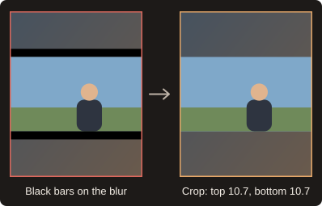
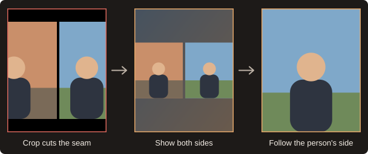
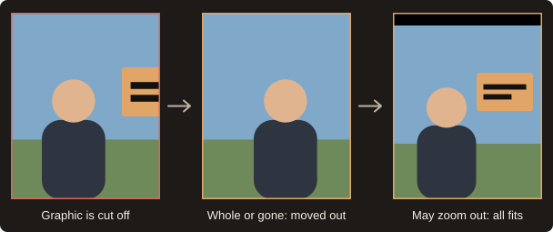

  

<strong>Frame one shot. We'll do the rest.</strong>

  <a href="https://github.com/GSK95/WildScale/releases/download/1.3.0/WildScale-1.3.0-mac-x86_64.pkg">Download for Mac</a> ·
  <a href="https://github.com/GSK95/WildScale/releases/download/1.3.5/WildScaleSetup-1.3.5.exe">Download for Windows</a> ·
  <a href="https://gsk95.github.io/WildScale/">Website</a> ·
  <a href="https://gsk95.github.io/WildScale/guide.html">User guide</a> ·
  <a href="https://gsk95.github.io/WildScale/privacy.html">Privacy</a>

WildScale is a panel for Adobe Premiere Pro that reframes a horizontal edit for Reels and other vertical formats. You frame a shot once, and WildScale carries that framing through the rest of your timeline, clip by clip, while you watch it happen.

  

## New in 1.3.5 for Windows

- **Sees the shot when you stop.** Rest the playhead on a frame and WildScale outlines the people, faces, objects and titles in it. Click one to mark it, or leave them and let WildScale decide. Auto detect can be turned off, and **Shift+C** still captures by hand.
- **Frames by what is in the shot.** Clips without a reference are framed by the people, cars, animals, food, screens and props in them.
- **Cuts dissolves and fades.** A dissolve is cut where the new shot takes over, and a fade through black in the black.
- **Stops cleanly.** Stop halts a run at once and puts back everything it changed.
- **Uses both graphics cards.** On a laptop with NVIDIA and AMD or Intel graphics, finding cuts takes about half the time.
- **Learns your edits.** Your references and hand fixes become measured decisions, and **Like my own edits** frames the timeline your way.

See the [release notes](https://github.com/GSK95/WildScale/releases/tag/1.3.5).

## What it does

- **Finds every cut.** Reads each frame, on your graphics card when the format allows it, and cuts video and audio on the timeline, with every piece linked to its sound.
- **Knows your speaker.** Set the framing once and matching shots across your cuts follow it.
- **Removes black bars.** Finds bars inside your footage and crops exactly that much, only on the sides that have them.
- **Reads split screens.** Keeps the crop off the seam, and shows both sides or follows the person.
- **Follows your rules.** Each reference decides which graphics may show, and whether it may zoom out to clear them.
- **Keeps titles whole.** Text that would leave the crop gets a small move or a clean two-layer back blur.
- **Pastes your framing.** Matching shots get your exact Scale and Position, and you can copy them onto any selection.
- **Works in your open sequence.** Clips change live on the timeline, with no new sequences, and you can stop whenever you like.
- **Follows motion.** With FFmpeg installed, WildScale finds changes inside long clips and plans each take on its own.
- **Groups your shots.** Colors speakers, titles and graphics on the timeline, with a grid of takes to check.
- **Remembers each sequence.** References, groups and history return when you select it, and a new reference only reworks the clips it touches.
- **Learns from your fixes.** It remembers the corrections you make and uses them on later runs.
- **Works within your memory.** Settings checks your system and adjusts to the memory Premiere leaves free.
- **Stays on your computer.** Frames are analyzed locally. Your footage is never uploaded.

## How it works

## System requirements

| | Required | Recommended |
|---|---|---|
| **Premiere Pro** | 25.0 or later | 26.5.2 or later, for every feature |
| **Operating system** | Windows 10 or 11, 64-bit, or macOS 13 or later on an Intel Mac | Windows 11 or macOS 15 |
| **Memory** | Enough left over beside Premiere | 16 GB or more |
| **Processor** | Any 64-bit processor | 4 cores or more |
| **Graphics card** | Not required | A DirectML-capable card, ideally NVIDIA. On Windows, two cards work together |
| **Disk space** | About 300 MB for WildScale | 2 GB or more free for temporary frames |
| **FFmpeg** | Not required | Installed, for faster cuts and motion detection |

The Mac version has been tested with Premiere Pro 26.0 on macOS 15 on an Intel MacBook Pro. Apple silicon Macs are not tested.

### What you might need to install

- **FFmpeg** is a free tool that WildScale does not include. It makes cut detection faster and powers motion detection. On Windows, install it with `winget install Gyan.FFmpeg`, then restart Premiere Pro. On a Mac with Homebrew, run `brew install ffmpeg`.
- **Without FFmpeg**, a slower built-in decoder finds the cuts and each clip is framed as a whole. Premiere's own Scene Edit Detection only runs when you tick it.
- **Administrator rights** are not needed on Windows. The Mac package asks for your password.
- **An internet connection** is only needed to download the installer. The face, text and object models are included.

### What to expect

- **With 16 GB of memory**, Premiere uses most of it, so **Auto** in **Settings** stays at **Balanced** or lower. These modes use less memory, but very short titles can be missed in long clips.
- **Below 4 GB of free memory**, WildScale switches to **Memory saver**. Below 1 GB, analysis pauses for up to 20 seconds to leave room for Premiere.
- **Without a supported graphics card**, everything still works on the processor, but text detection is slower.
- **ProRes and similar formats** are decoded on the processor, because graphics cards generally cannot decode them.
- **Low latency** in **Settings** is the lightest mode for older computers. On a computer with four cores or fewer, **Auto** picks it when memory runs low.
- **The Mac warning** appears because the package is not notarized by Apple yet. Open **System Settings > Privacy & Security** and choose **Open Anyway**.
- **The Windows warning** appears because the installer has a self-signed signature. Choose **More info**, then **Run anyway**.
- **In Premiere Pro 25.0 to 26.5.1**, you cannot color single clips, and the new cutting and paste tools are not fully tested yet.

**Settings** at the top of the panel checks your system and shows what is ready.

## Install

### Windows

1. Download [`WildScaleSetup-1.3.5.exe`](https://github.com/GSK95/WildScale/releases/download/1.3.5/WildScaleSetup-1.3.5.exe). You do not need administrator rights.
2. Run it and restart Premiere Pro.
3. Open the panel from the Window menu:
   - Premiere Pro 26.5.2 and later: **UXP Plugins**
   - Premiere Pro 25.0 to 26.5.1: **Extensions**

The installer also adds WildScale Monitor, a film strip in the system tray that runs when you sign in to Windows. It starts the analysis service when the panel asks, so there is nothing to start by hand. It is dim while the service sleeps, solid when it is awake, and rolls while a job runs.

### Mac

1. Quit Premiere Pro with Cmd+Q.
2. Download [`WildScale-1.3.0-mac-x86_64.pkg`](https://github.com/GSK95/WildScale/releases/download/1.3.0/WildScale-1.3.0-mac-x86_64.pkg) and open it. If macOS refuses, open **System Settings > Privacy & Security** and choose **Open Anyway**.
3. Start Premiere Pro and choose **Window > Extensions > WildScale**.

WildScale Monitor, a film strip in the menu bar, starts the service when the panel asks. It is dim while the service sleeps, solid when it is awake, and rolls while a job runs.

## Quick start

1. Duplicate your sequence if you want to keep the original. WildScale changes the open sequence directly.
2. Select your raw clip and click **Cut selected clips**.
3. Frame one shot of your speaker by hand and select that clip.
4. In **References**, pick a preset and click **Remember selected clips**.
5. Click **Rescale**.

The [user guide](https://gsk95.github.io/WildScale/guide.html) covers every part of the panel and troubleshooting.

## Status

WildScale 1.3.5 for Windows and 1.3.0 for Mac are pre-releases. To report a problem, email [drugela.music@gmail.com](mailto:drugela.music@gmail.com).

Downloads are on the [Releases](https://github.com/GSK95/WildScale/releases) page.

---

© 2026 Drugela. WildScale is an independent product and is not affiliated with or endorsed by Adobe. Adobe and Premiere Pro are trademarks of Adobe Inc.
