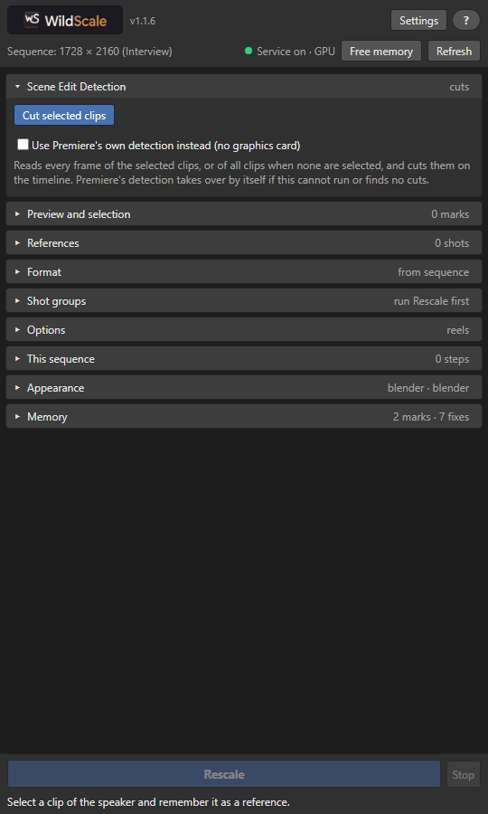

  

<strong>Frame one shot. We'll do the rest.</strong>

  <a href="https://github.com/GSK95/WildScale/releases/download/1.0.0/WildScaleSetup.exe">Download for Windows</a> ·
  <a href="https://gsk95.github.io/WildScale/">Website</a> ·
  <a href="https://gsk95.github.io/WildScale/guide.html">User guide</a> ·
  <a href="https://gsk95.github.io/WildScale/privacy.html">Privacy</a>

WildScale is a panel for Adobe Premiere Pro that reframes a horizontal edit for Reels and other vertical formats. You frame a shot once, and WildScale carries that framing through the rest of your timeline, clip by clip, while you watch it happen.

  

## What it does

- **Knows your speaker.** Set the framing once and matching shots across your cuts follow it.
- **Keeps titles whole.** Text that would leave the crop gets a small move or a clean two-layer back blur.
- **Works in your open sequence.** Clips change live on the timeline, with no new sequences, and you can stop whenever you like.
- **Follows motion.** With FFmpeg installed, WildScale finds changes inside long clips and plans each take on its own.
- **Groups your shots.** Find and select speakers, titles and graphics from the panel.
- **Learns from your fixes.** It remembers the corrections you make and uses them on later runs.
- **Stays on your computer.** Frames are analyzed locally. Your footage is never uploaded.

## Requirements

- Adobe Premiere Pro 25.0 to 25.9, or 26.5.2 and later
- Windows 10 or 11, 64-bit
- FFmpeg, only for motion detection

Premiere Pro 26.0 to 26.5.1 is not supported. A graphics card helps but is not required.

## Install

1. Download [`WildScaleSetup.exe`](https://github.com/GSK95/WildScale/releases/download/1.0.0/WildScaleSetup.exe). You do not need administrator rights.
2. Run it and restart Premiere Pro.
3. Open the panel from the Window menu:
   - Premiere Pro 26.5.2 and later: **UXP Plugins**
   - Premiere Pro 25.0 to 25.9: **Extensions**

The installer also adds a small launcher that runs when you sign in to Windows. It starts the analysis service when the panel asks, so there is nothing to start by hand.

## Quick start

1. Duplicate your sequence if you want to keep the original. WildScale changes the open sequence directly.
2. Frame one shot of your speaker by hand and select that clip.
3. In **References**, leave the preset on **Main speaker** and click **Remember selected clips**.
4. Click **Rescale**.

The [user guide](https://gsk95.github.io/WildScale/guide.html) covers every part of the panel and troubleshooting.

## Status

WildScale 1.0.0 is a pre-release. To report a problem, email [drugela.music@gmail.com](mailto:drugela.music@gmail.com).

Downloads are on the [Releases](https://github.com/GSK95/WildScale/releases) page.

---

© 2026 Drugela. WildScale is an independent product and is not affiliated with or endorsed by Adobe. Adobe and Premiere Pro are trademarks of Adobe Inc.
